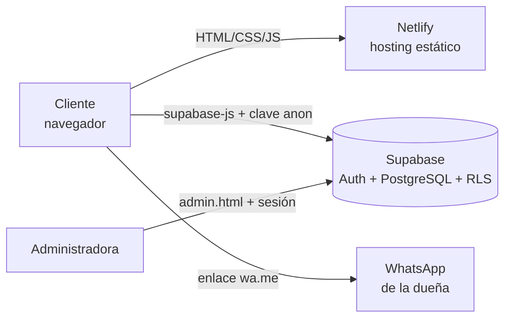

# SIGEPAL · Oro Verde

Sistema web de **pedidos y catálogo virtual de aceite de palta extra virgen** para la empresa **Oro Verde** (Moquegua, Perú).
El cliente elige su presentación, arma el pedido y lo envía por WhatsApp; la dueña administra pedidos, clientes, precios y stock desde un panel.

> Proyecto del curso **Ingeniería de Software** (Universidad Nacional de Moquegua, Ing. de Sistemas e Informática).
> Autor: Miguel Angel Flores Bermudez · Docente: Dr. Alexander Morales Gonzales.

**Web en producción:** `https://TU-SITIO.netlify.app` &nbsp;·&nbsp; **Panel:** `https://TU-SITIO.netlify.app/admin.html`


> Las capturas de `docs/capturas/` se generaron con **datos de prueba** (`npm run capturas`), no con pedidos reales de clientes.

## Funcionalidades

| Para el cliente | Para la administradora (panel) |
|---|---|
| Catálogo con precios (250 ml, 500 ml y 1 litro) | Pedidos con búsqueda, filtro por estado y cambio rápido de estado |
| Carrito con cantidades limitadas por el stock | Registro de pagos y aviso al cliente por WhatsApp |
| Opción de factura (+S/ 5 por unidad, IGV) | Clientes con cuenta e invitados, con su historial |
| Pedido enviado por WhatsApp con el mensaje ya escrito | Precios, stock y stock mínimo editables |
| Cuenta propia: historial de compras y repetir pedido | Alertas de stock bajo y agotado |

## Tecnologías

- **Frontend:** HTML, CSS y JavaScript sin framework (sin paso de compilación).
- **Backend como servicio:** [Supabase](https://supabase.com) (PostgreSQL + Auth + Row Level Security + funciones RPC).
- **Hosting:** [Netlify](https://netlify.com) (plan gratuito).
- **Pruebas:** `node:test` (unitarias) y [Playwright](https://playwright.dev) (extremo a extremo).
- **CI:** GitHub Actions.

## Arquitectura



Más detalle en [`docs/ARQUITECTURA.md`](docs/ARQUITECTURA.md) y los requisitos en [`docs/REQUISITOS.md`](docs/REQUISITOS.md).

```
.
├── index.html · admin.html      Páginas (catálogo y panel)
├── css/                         Estilos de cada página
├── js/
│   ├── logic.js                 Lógica pura (totales, validación, mensaje) → probada con tests unitarios
│   ├── index.js                 Catálogo, carrito, cuenta del cliente
│   └── admin.js                 Panel de administración
├── config.example.js            Plantilla de configuración
├── config.js                    Configuración del sitio (solo valores públicos)
├── database/                    Scripts SQL (esquema, cuentas y stock)
├── assets/                      Logo y foto del producto
├── docs/                        Arquitectura, requisitos, seguridad y capturas
├── tests/unit · tests/e2e       Pruebas automatizadas
└── .github/workflows            CI y mantenimiento de Supabase
```

## Instalación desde cero

Requisitos: cuenta gratuita en Supabase y Node.js 20+ (solo para correr las pruebas).

### 1. Clonar

```bash
git clone https://github.com/TU-USUARIO/oro-verde-sigepal.git
cd oro-verde-sigepal
```

### 2. Crear la base de datos (Supabase)

1. Crea un proyecto en <https://supabase.com> (por ejemplo `oroverde`).
2. **Authentication → Users → Add user**: crea el usuario de la administradora (marca *Auto Confirm User*).
3. **SQL Editor**: ejecuta `database/01_esquema_base.sql`.
4. Abre `database/02_cuentas_y_stock.sql`, cambia `correo_del_admin@ejemplo.com` por el correo del usuario del paso 2 y ejecútalo.
5. **Authentication → Sign In / Providers → Email**: deja activado *Allow new users to sign up* y desactiva *Confirm email*.

### 3. Configurar la web

```bash
cp config.example.js config.js
```

Edita `config.js` con el número de WhatsApp (con código de país), `SUPABASE_URL` y `SUPABASE_ANON_KEY` (**Project Settings → API**).

> **Sobre la clave `anon`:** es pública por diseño (viaja en cualquier web que use Supabase). La seguridad no depende de ocultarla,
> sino de las políticas **RLS** definidas en `database/`. **Nunca** pongas la clave `service_role` en este repositorio.
> Detalle en [`docs/SEGURIDAD.md`](docs/SEGURIDAD.md).

### 4. Ejecutar en local

```bash
npm start        # sirve la carpeta en http://localhost:3000
```

### 5. Publicar (Netlify)

Opción recomendada: **Add new site → Import an existing project → GitHub** y elige este repositorio (no necesita comando de build; carpeta de publicación `.`).
Cada `git push` a `main` actualiza la web automáticamente.

## Pruebas

```bash
npm install
npx playwright install chromium
npm test            # unitarias + E2E
npm run test:unit   # solo lógica (14 pruebas)
npm run test:e2e    # flujos en navegador (10 pruebas)
```

Cobertura de las pruebas (detalle en [`docs/PRUEBAS.md`](docs/PRUEBAS.md)): cálculo de totales y factura, límites por stock, validación de formularios
(campos vacíos, letras en el celular, textos largos), escape de HTML, mensaje de WhatsApp, diseño móvil, tiempo de carga y panel de administración.

## Seguridad

- Cada cliente solo puede leer **sus propios** pedidos (RLS).
- Solo los usuarios de la tabla `admins` acceden al panel y a los datos de todos.
- Los pedidos se crean con la función `crear_pedido`, que **recalcula el total en el servidor** con los precios de la base de datos (el navegador no decide el precio) y descuenta el stock.
- Todo texto que llega de la base de datos se escapa antes de mostrarse (prevención de XSS).

## Limitaciones conocidas

- El mensaje de WhatsApp lo envía el cliente desde su propio teléfono (enlace `wa.me`); un envío automático requeriría la API de WhatsApp Business.
- El plan gratuito de Supabase pausa el proyecto tras ~7 días sin actividad; el workflow `keepalive.yml` hace una consulta periódica para evitarlo (requiere configurar los secretos del repositorio).
- No hay pasarela de pago: el pago se coordina por WhatsApp (Yape, efectivo, etc.) y la administradora lo registra en el panel.

## Convención de trabajo

- Ramas: `main` (estable) ← `develop` (integración) ← `feature/*`.
- Commits con [Conventional Commits](https://www.conventionalcommits.org/es/): `feat:`, `fix:`, `docs:`, `test:`, `chore:`.
- Historial de cambios en [`CHANGELOG.md`](CHANGELOG.md).

## Licencia

[MIT](LICENSE) © 2026 Miguel Angel Flores Bermudez
