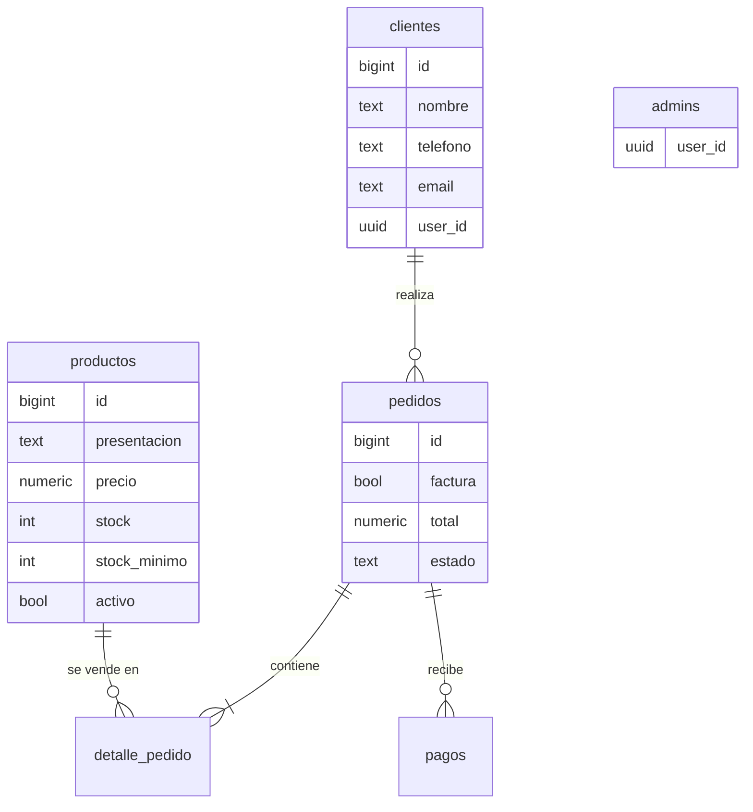
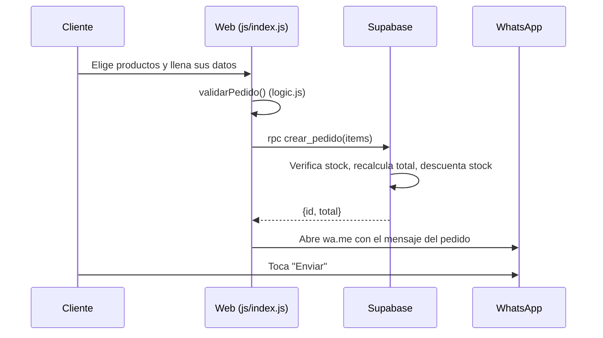

# Arquitectura

## Estilo
Aplicación web **estática** (sin servidor propio) que usa **Supabase como backend**. Es una arquitectura cliente-servidor por capas:

| Capa | Dónde | Responsabilidad |
|---|---|---|
| Presentación | `index.html`, `admin.html`, `css/` | Interfaz responsive |
| Lógica de cliente | `js/index.js`, `js/admin.js` | Eventos, render, llamadas a Supabase |
| Lógica pura | `js/logic.js` | Totales, validación, mensaje de WhatsApp (sin DOM ni red → se prueba con tests unitarios) |
| Datos y reglas | Supabase (PostgreSQL) | Tablas, RLS, funciones y triggers (`database/`) |

Principios aplicados: **separación de responsabilidades** (la lógica de negocio sale de la interfaz), **DRY** (funciones compartidas en `logic.js`) y **KISS** (sin frameworks ni compilación).

## Modelo de datos

## Flujo de un pedido

## Estados del pedido
`pendiente → confirmado → en_camino → entregado` (o `cancelado`, que devuelve el stock mediante el trigger `ajustar_stock_por_estado`).

## API
No hay API propia. Supabase expone una API REST/RPC generada a partir del esquema; las operaciones usadas son: lectura de `productos`, `rpc('crear_pedido')`, `rpc('es_admin')`, y lecturas/actualizaciones de `pedidos`, `clientes` y `pagos` sujetas a RLS.
